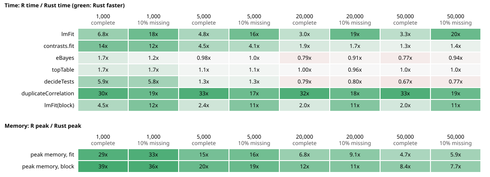

# limma-rust against R limma: speed and memory

- Machine: Apple M5 Pro, Darwin arm64
- R: R version 4.5.3 (2026-03-11), limma 3.66.0, libRblas.0.dylib
- Rust: rustc 1.95.0, release build
- Data: synthetic, 24 samples (four conditions of six, 12 donors with two technical replicates each), complete and with 10% of values missing at random
- Rust was faster in 45 of 56 stage and dataset pairs; the median speed-up is 2.2x, from 0.67x (decideTests, 50,000 complete) to 33x (duplicateCorrelation, 50,000 complete).
- Peak memory: R 93 to 368 MB, Rust 3 to 55 MB.

## How to read this

Both sides run the same limma calls on the same files, natively on the machine above and single-threaded. `fit` is lmFit, contrasts.fit, eBayes, topTable for each of the six contrasts and decideTests; `block` is duplicateCorrelation and then lmFit with the block and its consensus correlation.

- **Time** is the median of 3 runs of each stage inside one process, with the inputs already in memory, so start-up and reading files are left out. The speed-up is R's time divided by Rust's: 10x means Rust took a tenth of the time, under 1x means R was faster.
- **Peak memory** is the most resident memory the whole process held, from `/usr/bin/time`, one process per pipeline. It includes the runtime itself, which for R is the interpreter and limma, so it is what a container running the step would need. **Added** is that peak minus the peak of a process that only reads the inputs, which is closer to what the computation itself allocated.
- Missing values matter because they send R's lmFit from one matrix solve for all proteins to a loop that fits each protein on its own.
- These are one machine's numbers on one day and move by tens of percent between runs, so read the size of a ratio, not its last digit. Nothing fails on them.

## Time (seconds)

| dataset | stage | R | Rust | R / Rust |
|---|---|---:|---:|---:|
| 1,000 complete | lmFit | 9.0e-04 | 1.3e-04 | 6.8x |
| 1,000 complete | contrasts.fit | 3.3e-04 | 2.4e-05 | 14x |
| 1,000 complete | eBayes | 1.3e-03 | 7.9e-04 | 1.7x |
| 1,000 complete | topTable | 2.8e-03 | 1.6e-03 | 1.7x |
| 1,000 complete | decideTests | 6.5e-04 | 1.1e-04 | 5.9x |
| 1,000 complete | duplicateCorrelation | 0.164 | 5.4e-03 | 30x |
| 1,000 complete | lmFit(block) | 1.2e-03 | 2.6e-04 | 4.5x |
| 1,000 10% missing | lmFit | 0.015 | 8.3e-04 | 18x |
| 1,000 10% missing | contrasts.fit | 3.6e-04 | 2.9e-05 | 12x |
| 1,000 10% missing | eBayes | 3.2e-03 | 2.7e-03 | 1.2x |
| 1,000 10% missing | topTable | 2.9e-03 | 1.7e-03 | 1.7x |
| 1,000 10% missing | decideTests | 6.9e-04 | 1.2e-04 | 5.8x |
| 1,000 10% missing | duplicateCorrelation | 0.231 | 0.012 | 19x |
| 1,000 10% missing | lmFit(block) | 0.026 | 2.2e-03 | 12x |
| 5,000 complete | lmFit | 3.2e-03 | 6.7e-04 | 4.8x |
| 5,000 complete | contrasts.fit | 4.9e-04 | 1.1e-04 | 4.5x |
| 5,000 complete | eBayes | 4.4e-03 | 4.4e-03 | 0.98x |
| 5,000 complete | topTable | 0.010 | 9.4e-03 | 1.1x |
| 5,000 complete | decideTests | 1.7e-03 | 1.3e-03 | 1.3x |
| 5,000 complete | duplicateCorrelation | 0.839 | 0.025 | 33x |
| 5,000 complete | lmFit(block) | 3.0e-03 | 1.3e-03 | 2.4x |
| 5,000 10% missing | lmFit | 0.063 | 3.9e-03 | 16x |
| 5,000 10% missing | contrasts.fit | 4.4e-04 | 1.1e-04 | 4.1x |
| 5,000 10% missing | eBayes | 0.014 | 0.014 | 1.0x |
| 5,000 10% missing | topTable | 0.010 | 9.3e-03 | 1.1x |
| 5,000 10% missing | decideTests | 1.5e-03 | 1.2e-03 | 1.3x |
| 5,000 10% missing | duplicateCorrelation | 1.06 | 0.062 | 17x |
| 5,000 10% missing | lmFit(block) | 0.113 | 0.011 | 11x |
| 20,000 complete | lmFit | 7.4e-03 | 2.5e-03 | 3.0x |
| 20,000 complete | contrasts.fit | 7.8e-04 | 4.2e-04 | 1.9x |
| 20,000 complete | eBayes | 0.015 | 0.018 | 0.79x |
| 20,000 complete | topTable | 0.039 | 0.039 | 1.00x |
| 20,000 complete | decideTests | 4.7e-03 | 5.9e-03 | 0.79x |
| 20,000 complete | duplicateCorrelation | 3.25 | 0.101 | 32x |
| 20,000 complete | lmFit(block) | 9.9e-03 | 5.0e-03 | 2.0x |
| 20,000 10% missing | lmFit | 0.257 | 0.013 | 19x |
| 20,000 10% missing | contrasts.fit | 7.6e-04 | 4.4e-04 | 1.7x |
| 20,000 10% missing | eBayes | 0.051 | 0.056 | 0.91x |
| 20,000 10% missing | topTable | 0.038 | 0.039 | 0.96x |
| 20,000 10% missing | decideTests | 4.8e-03 | 6.1e-03 | 0.80x |
| 20,000 10% missing | duplicateCorrelation | 4.27 | 0.232 | 18x |
| 20,000 10% missing | lmFit(block) | 0.459 | 0.043 | 11x |
| 50,000 complete | lmFit | 0.020 | 6.2e-03 | 3.3x |
| 50,000 complete | contrasts.fit | 1.5e-03 | 1.1e-03 | 1.3x |
| 50,000 complete | eBayes | 0.036 | 0.047 | 0.77x |
| 50,000 complete | topTable | 0.101 | 0.101 | 1.0x |
| 50,000 complete | decideTests | 0.011 | 0.016 | 0.67x |
| 50,000 complete | duplicateCorrelation | 8.35 | 0.252 | 33x |
| 50,000 complete | lmFit(block) | 0.025 | 0.012 | 2.0x |
| 50,000 10% missing | lmFit | 0.686 | 0.034 | 20x |
| 50,000 10% missing | contrasts.fit | 1.6e-03 | 1.2e-03 | 1.4x |
| 50,000 10% missing | eBayes | 0.136 | 0.145 | 0.94x |
| 50,000 10% missing | topTable | 0.105 | 0.103 | 1.0x |
| 50,000 10% missing | decideTests | 0.013 | 0.016 | 0.77x |
| 50,000 10% missing | duplicateCorrelation | 11.02 | 0.583 | 19x |
| 50,000 10% missing | lmFit(block) | 1.18 | 0.107 | 11x |

## Memory (MB)

| dataset | pipeline | R peak | Rust peak | R / Rust | R added | Rust added |
|---|---|---:|---:|---:|---:|---:|
| 1,000 complete | fit | 93 | 3.2 | 29x | 3 | 0.7 |
| 1,000 complete | block | 130 | 3.3 | 39x | 40 | 0.8 |
| 1,000 10% missing | fit | 112 | 3.4 | 33x | 22 | 0.9 |
| 1,000 10% missing | block | 137 | 3.8 | 36x | 47 | 1.3 |
| 5,000 complete | fit | 106 | 7.3 | 15x | 8 | 1.5 |
| 5,000 complete | block | 143 | 7.2 | 20x | 44 | 1.4 |
| 5,000 10% missing | fit | 127 | 7.9 | 16x | 29 | 2.2 |
| 5,000 10% missing | block | 145 | 7.7 | 19x | 48 | 2.0 |
| 20,000 complete | fit | 155 | 22.7 | 6.8x | 21 | 4.2 |
| 20,000 complete | block | 213 | 18.5 | 12x | 79 | 0.0 |
| 20,000 10% missing | fit | 210 | 23.1 | 9.1x | 78 | 5.2 |
| 20,000 10% missing | block | 201 | 17.9 | 11x | 69 | 0.0 |
| 50,000 complete | fit | 253 | 53.9 | 4.7x | 39 | 10.3 |
| 50,000 complete | block | 368 | 43.7 | 8.4x | 154 | 0.1 |
| 50,000 10% missing | fit | 327 | 55.2 | 5.9x | 124 | 13.2 |
| 50,000 10% missing | block | 325 | 42.0 | 7.7x | 123 | 0.0 |
